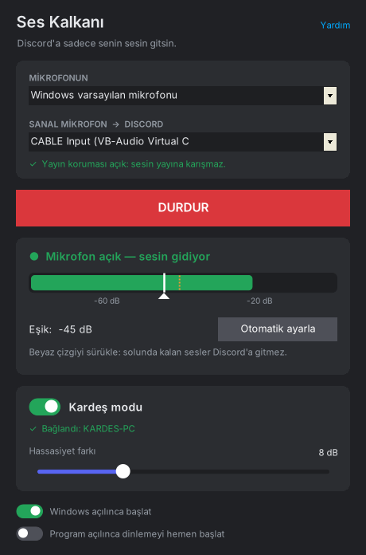

# 🛡️ Ses Kalkanı

**Aynı odada oyun oynarken kardeşinin (ya da oda arkadaşının) sesi senin mikrofonundan Discord'a gitmesin.**

Ses Kalkanı, mikrofonunla Discord arasına giren küçük bir Windows programıdır. İki şekilde korur:

1. **Eşik (noise gate):** Belli bir seviyenin altındaki sesleri hiç göndermez, OBS'deki noise gate gibi.
2. **Kardeş modu:** İki bilgisayar aynı ağ (modem) üzerinden birbiriyle haberleşir. Kardeşinin mikrofonu sesi
   seninkinden çok daha yüksek duyuyorsa konuşan kişi odur; senin mikrofonun o an otomatik susturulur.
   Asıl işi gören özellik budur.

<p align="center"></p>

- Kurulum yok, tek bir `.exe` (~70 KB)
- Arka planda saatin yanındaki simge alanında çalışır, Windows açılınca kendiliğinden başlayabilir
- "Otomatik ayarla" ile 10 saniyede eşik ayarı
- **Yayın koruması:** Discord'da ekran paylaşırken sesin yayına karışıp eko yapmaz
- **Güncelleme bildirimi:** yeni sürüm çıkınca pencerede ve simge alanında haber verir (kendisi bir şey indirmez)
- Ek kütüphane yok: Windows'un kendi ses API'leri (winmm, WASAPI) ve .NET Framework 4

> *English: Ses Kalkanı ("Voice Shield") is a tiny Windows noise gate for two people gaming in the same room.
> Both PCs talk over the LAN; when your sibling's mic hears a voice much louder than yours does, your mic is muted,
> so their voice never leaks into your Discord. Output goes to Discord through the free VB-Cable virtual microphone.*

## ⬇️ İndir

👉 **[Son sürümü indir (Releases)](https://github.com/Mehmetsndl/ses-kalkani/releases/latest)** → `SesKalkani.exe`

İmzasız bir program olduğu için Windows "bilgisayarınızı korudu" uyarısı verebilir: **Ek bilgi → Yine de çalıştır**.

## Kurulum

Bu adımları **iki bilgisayarda da** yapın.

### 1. VB-Cable kur (bir kere, ücretsiz)

Ses Kalkanı temizlediği sesi Discord'a sanal bir mikrofon üzerinden verir.

1. [vb-audio.com/Cable](https://vb-audio.com/Cable/) adresinden zip'i indirip bir klasöre çıkar.
2. `VBCABLE_Setup_x64.exe` → sağ tık → **Yönetici olarak çalıştır** → **Install Driver**.
3. Bilgisayarı yeniden başlat.

### 2. Ses Kalkanı'nı aç

1. `SesKalkani.exe`'yi istediğin bir klasöre koy ve çift tıkla.
2. Güvenlik duvarı sorarsa **iki kutuyu da** (Özel ve Ortak ağlar) işaretle → **Erişime izin ver**. Kardeş modu için şart.
3. **Mikrofonun:** kendi mikrofonunu seç (emin değilsen "Windows varsayılan").
4. **Sanal mikrofon:** `CABLE Input (VB-Audio Virtual C...` (kendisi seçer).
5. **BAŞLAT**'a bas. "Kardeş modu" açık kalsın; ikinizde de başlayınca altta `✓ Bağlandı: <bilgisayar adı>` yazar.

### 3. Discord ayarı

**Kullanıcı Ayarları → Ses ve Görüntü:**

- **Giriş cihazı:** `CABLE Output (VB-Audio Virtual Cable)`
- **Çıkış cihazı:** kulaklığın (değiştirme)

### 4. Otomatik ayar (bir kere)

BAŞLAT'tan sonra **Otomatik ayarla**'ya bas:

1. 5 saniye **sen sus**, kardeşin normal sesiyle konuşsun.
2. 5 saniye **sen konuş**.

Program eşiği kendisi ayarlar.

## Gösterge

| Görünüm | Anlamı |
|---|---|
| 🟩 Yeşil çubuk | Mikrofon açık, sesin gidiyor |
| 🟧 Turuncu çubuk | Kardeşin konuşuyor, senin mikrofonun susturuldu |
| ⬜ Gri çubuk | Ses eşiğin altında, hiçbir şey gitmiyor |
| Beyaz çizgi | Eşik. Fareyle sürükleyerek elle ayarlanır |
| Turuncu noktalı çizgi | Kardeşinin mikrofonunun duyduğu ses |

## Sorun giderme

- **Konuşurken bazen kesiliyorum:** Beyaz çizgiyi biraz sola çek. Kardeş modunda "Hassasiyet farkı"nı artır (örn. 12 dB).
- **Kardeşimin sesi hâlâ ara ara geçiyor:** Beyaz çizgiyi biraz sağa çek, "Hassasiyet farkı"nı azalt (örn. 5 dB).
  Mikrofonu ağzına yaklaştır; ne kadar yakınsa ayrım o kadar iyi olur.
- **"Kardeşin bekleniyor..." yazısı gitmiyor:** İki bilgisayar aynı modemde mi, ikisinde de BAŞLAT'a basılı ve kardeş modu açık mı?
  Güvenlik duvarı izni için: Başlat → "Windows Defender Güvenlik Duvarı aracılığıyla bir uygulamaya izin ver" → SesKalkani → iki kutu.
- **Discord'a hiç ses gitmiyor:** Discord'da giriş cihazı `CABLE Output` mu, programda BAŞLAT'a basılı mı?
  Windows Ayarları → Gizlilik → Mikrofon → "Masaüstü uygulamalarının erişimine izin ver" açık mı?
- **Discord'da yayın açınca sesim eko yapıyor:** Discord ekranı sesli paylaşınca programların sesini yayına ekler;
  Ses Kalkanı'nın sanal kabloya verdiği ses (senin mikrofonun) da yayına girerdi. **Yayın koruması** bunu engeller:
  BAŞLAT'tan sonra cihaz kartında yeşil `✓ Yayın koruması açık` yazmalı. Turuncu "çalışmıyor" yazıyorsa:
  Ses Denetim Masası → **Kayıttan yürütme** → `CABLE Input` → Özellikler → **Gelişmiş** →
  "Uygulamaların bu aygıtın özel denetimini almasına izin ver" kutusunu işaretle, sonra DURDUR / BAŞLAT.
  Yine olmazsa yayında tüm ekran yerine oyunun penceresini paylaş (Discord'da "Uygulamalar" sekmesi).
- **Exe'yi başka klasöre taşıdım:** Programı bir kere elle aç; Windows başlangıç kaydı yeni yere göre güncellenir.

## Arka planda çalışma

- Penceredeki **X** programı kapatmaz, simge alanına küçültür. Simgeye tıklayınca pencere geri gelir.
- Tamamen kapatmak için simgeye **sağ tık → Çıkış**. Kapatırsan Discord'a ses gitmez.
- **Windows açılınca başlat** varsayılan olarak açık: program pencere göstermeden başlar ve dinlemeye geçer.
- Yeni sürüm çıktığında başlığın sağında yeşil **↑ Yeni sürüm mevcut** yazısı ve bir bildirim çıkar.
  Tıklayınca indirme sayfası açılır; indirip eski exe'nin yerine koyman yeterli.
- Ayarlar: `%APPDATA%\SesKalkani\ayarlar.ini`

## Nasıl çalışır?

- `src/Audio.cs`: winmm ile mikrofondan okuma ve sanal mikrofona yazma; kardeş modu için yerel ağda UDP yayını (port **47811**).
- `src/WasapiOut.cs`: yayın koruması. Sanal mikrofona WASAPI **özel mod** ile yazar; özel mod Windows ses karıştırıcısını
  atladığı için Discord'un ekran paylaşımı ses yakalaması mikrofonunu göremez. Açılamazsa normal moda (winmm) döner.
- `src/Fifo.cs`: mikrofon ile sanal kablo arasındaki tampon, örnekleme hızı dönüşümü ve saat kayması düzeltmesi.
- `src/Gate.cs`: eşik ve iki mikrofonun seviye karşılaştırması (hassasiyet farkı, dB).
- `src/MainForm.cs`: arayüz, simge alanı, otomatik ayar ve başlangıç kaydı.

Ses kaydedilmez ve ağa ses gönderilmez; iki bilgisayar arasında yalnızca anlık ses **seviyesi** ve bilgisayar adı paylaşılır.
Güncelleme kontrolü için program açılışta ve 6 saatte bir GitHub'dan yalnızca son sürüm numarasını sorar.

## Derleme

Windows'ta yerleşik .NET Framework 4 derleyicisi yeterli, Visual Studio gerekmez:

```bat
build.bat
```

Çıktı: `dist\SesKalkani.exe`. Commit mesajında `[release]` geçen her gönderimde GitHub Actions programı derleyip
Releases sayfasına ekler (sürüm numarası `src/AssemblyInfo.cs` içinde).

## Lisans

MIT. Ayrıntılar için [LICENSE](LICENSE).
